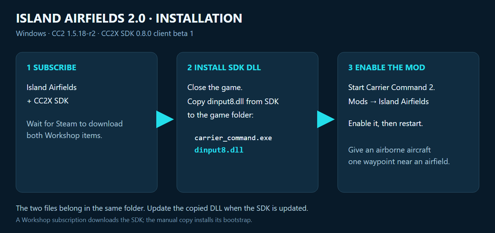
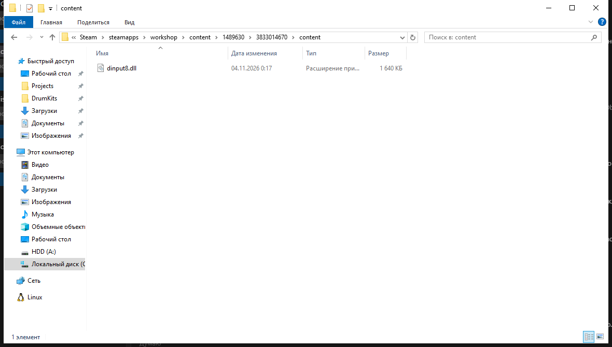
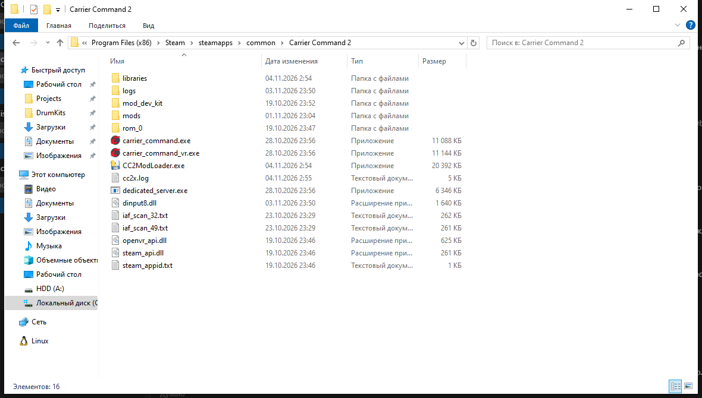

# Installation - Island Airfields 2.2

Island Airfields is now a separate addon for stock CC2 and Revolution 1.6-19/1.6-20.
For Revolution, subscribe to its [original Workshop item](https://steamcommunity.com/sharedfiles/filedetails/?id=3460002110)
and enable **both Revolution and Island Airfields**. No combined repack or file
replacement is required. The addon contains no Revolution files.

Windows / reviewed CC2 1.5.18-r2 client. Requires **CC2X SDK 0.9.0-dev preview**.



## 1. Subscribe to the mod and SDK

Subscribe to [Island Airfields](https://steamcommunity.com/sharedfiles/filedetails/?id=3826940003)
and [CC2X SDK](https://steamcommunity.com/sharedfiles/filedetails/?id=3833014670).
Wait for Steam to finish downloading both. Subscribing downloads the SDK; the
manual copy below installs its bootstrap.

## 2. Find the SDK DLL

With the game closed, open this folder inside your Steam library:

```text
steamapps/workshop/content/1489630/3833014670/content
```



Copy **dinput8.dll**. You can also [download that file from the exact SDK release](https://github.com/Dioramawhois/Carrier-Command-2-extender/releases/download/0.9.0-dev/dinput8.dll).

## 3. Open the game folder

In Steam choose **Library > Carrier Command 2 > gear icon > Manage > Browse local files**.
Copy the DLL beside the game executable:

```text
Carrier Command 2/
    carrier_command.exe
    dinput8.dll
```



The screenshots illustrate file names and placement; Windows language, dates and
your Steam library location may differ. Use the SDK 0.9.0-dev download linked above.
Keep a backup of an older identified CC2X runtime; check compatibility before
replacing a different loader.

## 4. Enable the mod

Start the game, open **Mods**, enable **Island Airfields**, then restart. After
future SDK updates, repeat the DLL copy with the game closed. Steam does not
update a manually copied DLL automatically.

## Updating an older setup

The new mod contains Lua/content. It does not need a separate
`cc2x_island_airfields.dll`. With the game closed, take only a previously manually
installed Island Airfields DLL out of its loading location. Keep the shared SDK
and unrelated plugins. Enable one Island Airfields copy at a time.

ModLoader must explicitly support this exact SDK 0.9.0-dev runtime for automatic
installation. Until your build supports it, use the manual route above. The
reviewed stock/Revolution screens use checked in-memory edits. Other screen
versions are skipped and logged; they require a reviewed compatibility profile.

## First check

1. Start single-player or an ordinary-host session. Custom with several starting islands is convenient.
2. Airfield markers use actual facility positions when available; never-streamed islands may still need an approach.
3. Drag an airborne aircraft onto the explicit airfield icon on the control map to land.
4. Click the airfield, then its parked aircraft. Edit hardpoints on its carrier-style picture; use Launch at the bottom and select a map destination.
5. A replacement order before touchdown cancels the landing.

Planes and helicopters are enabled by default. Include `cc2x.log` from the game
folder, versions, enabled mods and reproduction steps with a problem report.

Ordinary-host gameplay and map checks passed manual tests. A second remote client
and dedicated servers remain unverified.
